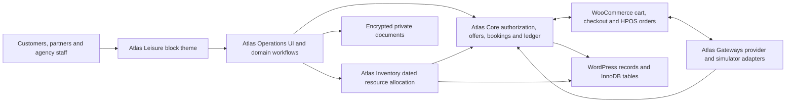

# Atlas Leisure

Atlas Leisure is a WordPress block theme and four companion plugins for a bilingual travel, leisure, education and retail agency. The theme provides an editable English and Persian storefront. The plugins connect approved offers, dated inventory, customer accounts, bookings, partner workspaces and agency operations to WooCommerce orders and checkout.

**0.2.0 · `VERIFIED_LOCAL` · 18 November 2026.** The frozen build passed verification on WordPress 7.1.4 and WooCommerce 11.3.0. The repository contains installable package sources, original specifications and source-linked local evidence. Production acceptance, live provider use and external delivery still require the gates documented below. [Release decision](implementation/RELEASE-READINESS.md) · [Project review](implementation/PROJECT-REVIEW.md) · [Changelog](implementation/IMPLEMENTATION-CHANGELOG.md)

> **راهنمای سریع فارسی:** از ریشهٔ مخزن ابتدا `npm ci --ignore-scripts` و سپس `npm run demo` را اجرا کنید. پس از راه‌اندازی، [فروشگاه فارسی](http://127.0.0.1:8840/?lang=fa)، [حساب مشتری](http://127.0.0.1:8840/?atlas_area=account&lang=fa) و [پنل آژانس و همکاران](http://127.0.0.1:8840/?atlas_area=portal&lang=fa) در دسترس‌اند. اطلاعات ورود آزمایشی در `.runtime/credentials.json` قرار دارد. دستور `npm run package` فایل‌های ZIP نصب را در `dist/` می‌سازد.

## Contents

- [Quick start](#quick-start)
- [Product scope and workflows](#product-scope-and-workflows)
- [Architecture and repository layout](#architecture-and-repository-layout)
- [Storefront, localization and accessibility](#storefront-localization-and-accessibility)
- [REST API and extension points](#rest-api-and-extension-points)
- [Packages, installation and upgrades](#packages-installation-and-upgrades)
- [Configuration and operating procedures](#configuration-and-operating-procedures)
- [Verification and release evidence](#verification-and-release-evidence)
- [Production acceptance](#production-acceptance)
- [Documentation and specification index](#documentation-and-specification-index)
- [License and attribution](#license-and-attribution)

## Quick start

Run from the repository root in a POSIX shell. Install Python 3, WP-CLI, PHP CLI with the WordPress/WooCommerce extensions including `mysqli`, and the MariaDB tools `mariadbd`, `mariadb-admin`, `mariadb-install-db`, `mariadb` and `mariadb-dump`. Private document flows require PHP Sodium and Fileinfo. Install Node.js and npm for the project scripts and browser checks. Fresh setup downloads the versions in the runtime lock and the Persian language packs. Setup reuses an existing local installation and refreshes the lock's observed environment. [Runtime lock](deploy/runtime.lock.json) · [Setup implementation](deploy/local.py)

| Component | Recorded verification version |
| --- | --- |
| WordPress / WooCommerce | 7.1.4 / 11.3.0 |
| PHP / MariaDB | 8.5.8 / 13.0.2 |
| Node.js / WP-CLI | 26.12.0 / 2.12.0 |
| PHP declarations | Theme 8.0+ when installed alone. Full platform 8.2+. |

The version declarations are package requirements. The local compatibility evidence applies to the recorded stack. [Theme header](wp-content/themes/atlas-leisure/style.css) · [Composer definition](composer.json) · [Test environment](implementation/TEST-EVIDENCE.md)

```sh
npm ci --ignore-scripts
npm run demo
```

The demo prepares WordPress, activates the five Atlas packages, migrates their local schemas, seeds fictional records and starts the web server. It uses a project-owned MariaDB socket and a 32 MB InnoDB buffer. PHP serves loopback only on port 8840. The runtime runs at low process priority. Browser tests run headlessly and use one worker.

| Open after startup | English | فارسی |
| --- | --- | --- |
| Storefront | [Browse](http://127.0.0.1:8840/?lang=en) | [فروشگاه](http://127.0.0.1:8840/?lang=fa) |
| Customer account | [My account](http://127.0.0.1:8840/?atlas_area=account&lang=en) | [حساب من](http://127.0.0.1:8840/?atlas_area=account&lang=fa) |
| Agency and partner workspace | [Partner portal](http://127.0.0.1:8840/?atlas_area=portal&lang=en) | [پنل همکاران](http://127.0.0.1:8840/?atlas_area=portal&lang=fa) |
| WordPress administration | [Dashboard](http://127.0.0.1:8840/wp-admin/) | [پیشخوان](http://127.0.0.1:8840/wp-admin/) |

Use the generated agency or fictional customer credentials in `.runtime/credentials.json`. The demo uses whole Iranian rials (IRR), the `Asia/Tehran` site timezone, High-Performance Order Storage (HPOS) and signed-in checkout. The simulator moves no funds. The local mail guard blocks outbound WordPress email, including password resets. New local accounts can register with a chosen password. Keep credentials and dumps private. [Demo fixtures](deploy/seed.php) · [Local mail guard](deploy/local-mail.php)

| Command | Result |
| --- | --- |
| `npm run setup` | Prepare WordPress, link the working sources, activate the five packages and apply local migrations. The DB starts. Demo seeding and the HTTP server are separate. |
| `npm run demo` | Prepare, seed and serve the fictional demo. Some tour and cohort examples start in draft for review. |
| `npm run start` | Serve an existing runtime with its saved data. |
| `python3 deploy/local.py health` | Report database reachability, the WordPress installation check and the configured URL. Check HTTP separately. |
| `npm run stop` | Stop this project's web and DB processes and preserve local data. |

**Try a service booking.** Sign in as the fictional customer, filter the catalog to Events and open the published demo event. Reserve and pay with the test simulator, then check the pending reservation in My account. In a separate agency session, open the confirmation queue, record a reason and confirm the service. Back in the customer's account, refresh and open the printable voucher. To try normal WooCommerce fulfillment, use the seeded physical product and fictional offline checkout.

## Product scope and workflows

The intended operating model is one agency per WordPress site, with separately scoped partner organizations. Agency staff review public content, confirm services, manage finance and coordinate fulfillment. Partners include tour leaders, instructors and venues, properties, fleet and dispatch operators, and makers. The specifications describe package margin and commission, admissions and tuition, retail and wholesale, and contracted services as business models. Each commercial arrangement depends on the agency's approved terms. [Vision and business model](docs/DOC-01_VISION-BUSINESS-MODEL.md) · [Personas and journeys](docs/DOC-03_PERSONAS-JTBD-JOURNEYS.md) · [Scope and roadmap](docs/DOC-05_SCOPE-MVP-ROADMAP.md)

### Module coverage

| Module | Available in the local release | Remaining scope or acceptance |
| --- | --- | --- |
| Storefront and discovery | Site Editor templates, bilingual catalog, normalized Persian/Arabic search, typed filters, pagination, comparisons, freshness and reviewed guides | Approved content and creative review, licensed map/search and supplier feeds |
| Tours | Reusable itinerary versions, reviewed departures and timezones, rooming and private manifests, assigned operations and booked-change consent | Real suppliers, final itineraries and staffed rehearsal |
| Events | Tier and session quotas, reviewed recurrence, waitlists, attendee forms with eligibility rules, QR tickets and an offline scan queue with authorized sync | Physical-device rehearsal and venue/catering operations |
| Academy | Reviewed courses and cohorts, group learners linked to a payer, restricted materials, attendance, assessments, appeals and certificate verification/revocation | Instructor and learner acceptance, accreditation or external LMS agreements where chosen |
| Accommodation | Dated quotes, room-night and villa capacity, WooCommerce checkout, independent supplier and agency review, cancellation and refund review | Multiple rates and allotments, PMS or approved channel reconciliation |
| Rentals | Dated fleet allocation and prices, eligibility, blackout/maintenance and turnaround, pickup, return and disputes | Inspection procedures, insurer verification and external deposit handling |
| Transfers | Scoped manual dispatch, driver assignment and state through waiting and no-show, schedule conflict guards | Staffed field operations and any approved tracking provider |
| Flights, rail and buses | Signed-in private inquiry and agency review | Licensed supplier shopping, holds, ticket issue, changes and refunds |
| Physical products and procurement | WooCommerce shipping and offline checkout, private RFQs and bids, split awards, artwork/proofs, sample/QC and manual payable tracking | Wider shipping, product and refund scenarios, approved maker agreements and actual settlements |
| Partner onboarding | Scoped applications, expiring staff invitations, membership revocation, versioned contracts and authority attestations | Business verification, reviewed legal signing, invitation delivery and operating acceptance |
| Service commerce | Dedicated Woo products for offers, signed-in checkout, Blocks and HPOS, quoted-price reservation and printable EN/FA voucher after confirmation | General tax/fee requotes, bundles, coupons and statutory invoices |
| Payments and finance | Fictional payment simulator, prepared ZarinPal V4, durable payment facts, ledger, refund review and manual bank evidence | Merchant acceptance, chargebacks, actual refunds, payouts and statement reconciliation |
| Support and notifications | Customer case threads, private internal notes, agency triage, reviewed bilingual in-account notices, outbox retries and worker health | External email/SMS/CRM, staff escalation and SLA, complete history navigation |
| Private data | Purpose-limited encrypted document storage, review, retention, legal hold, portability and erasure workflow | Real scanner, approved retention, key/file recovery and independent privacy and security assessment |

The specification roadmap runs from R0 through MVP, P2, P3 and future work. The local release includes selected later-phase flows, including dated resources, procurement and certificates. Use the feature-by-feature evidence for implementation status and the original roadmap for planned scope. Requirements and acceptance criteria are indexed below. [Feature coverage and gaps](implementation/FEATURE-GAPS.md) · [Local release coverage](implementation/RELEASE-READINESS.md)

### Customer reservation and purchase

1. Browse published offers and guides in English or Persian. Sign in, select eligible travelers or learners where required and accept the versioned offer or dated quote. The purchaser, learner, traveler and guardian may have different roles.
2. Request the hold before registration closes. Core validates the offer version, eligibility, exact integer IRR amount and remaining capacity. The hold stores the accepted terms and expires at the earlier of ten minutes after reservation or the close of registration for a standard hold. Registration uses a half-open UTC interval. Dated inventory uses the property's or resource's configured local schedule. Direct offer links use `?offer_id=<id>&lang=en` or `lang=fa`.
3. Pay through the linked WooCommerce checkout. Atlas keeps physical goods and service holds in separate cart flows. Service checkout binds the accepted booking to its dedicated Woo product and order. The local simulator verifies a fictional payment. WooCommerce handles ordinary physical orders, shipping and configured offline methods.
4. View the order receipt and **My reservations**. Review proceeds through supplier and agency steps where required. A confirmed service exposes an owner-scoped printable voucher. Supplier issuance and service fulfillment have separate lifecycles.
5. Use the account's support or eligible cancellation flow if plans change. Releasing an allocation can create finance review. A refund request, its approval and a reconciled transfer each have separate states.

| Booking state | Meaning |
| --- | --- |
| `held` / `pending_payment` | Temporary capacity or payment awaiting verification. Observe the hold deadline. |
| `paid_pending_confirmation` | Verified money linked to an allocation awaiting confirmation. |
| `confirmed` / `fulfilled` | Confirmed entitlement or recorded fulfillment. |
| `expired` / `canceled` | Allocation expired or reservation was canceled. |
| `exception` | Review the payment and booking separately. A late verified payment after release cannot reacquire capacity. |

Keep the recorded receipt, allocation and payment evidence together during review. An excess payment can require finance review while an earlier confirmed entitlement remains valid. Audit reasons and references are recorded on protected workflows. [Booking policy](docs/DOC-24_BOOKING-INVENTORY-REGISTRATION.md) · [WooCommerce design](docs/DOC-25_WOOCOMMERCE-COMMERCE-ENGINE.md) · [Booking implementation](wp-content/plugins/atlas-core/src/Booking.php)

### Roles and agency operations

| Actor | Scope |
| --- | --- |
| Visitor | View approved catalog, guides and available public projections. |
| Customer or authorized learner | Access owned reservations, travelers, order receipts and support. Enrollment and consent rules govern learner-only content. |
| Partner `viewer` | Read within active organization membership and allowed object scope. |
| Partner `contributor`, `editor`, `leader`, `manager`, `partner_admin` or `owner` | Read and write where the WordPress capability ceiling, active membership and domain policy allow. Assignments and record scope limit operational access. |
| Agency staff | Use the agency workspace for review, dispatch, confirmations and support. Agency endpoints apply their required checks. Finance and sensitive documents add explicit capability requirements. |

Partner approval creates an organization and active membership. Expiring invitations and membership revisions constrain access changes. Staff prepare drafts and submit current versions for independent agency review. Suppliers and assigned operators receive the fields needed for their task, for example dated stay review, driver assignment or a maker bid. Revocation removes organization access. [Authorization implementation](wp-content/plugins/atlas-core/src/Auth.php) · [Identity and tenancy design](docs/DOC-23_IDENTITY-RBAC-TENANCY.md)

In the **Partner portal**, use the **Booking confirmation queue** to find a paid reservation, review fulfillment evidence and record the confirmation reason. Use the finance queue to inspect verified references and ledger entries, then record and review any refund request in whole IRR. A verified refund debit requires reconciled server proof. Use **Customer support queue** for case state, a shared reply or an explicitly private internal note. Use partner workspaces to submit offers, manage scoped availability or report fulfillment. [Agency and customer procedures](implementation/PARTNER-USER-MANUALS/README.md) · [Current module coverage](implementation/FEATURE-GAPS.md)

- **Dated stay or rental.** Configure a reviewed resource and its availability, request a quote for local dates and have the customer accept it at checkout. For a stay, the assigned supplier reviews before the agency confirms. Rental pickup and return use the assigned vehicle and eligibility record.
- **Event or cohort.** Review the schedule and allocation before publication. Use the assigned check-in scope for event admissions and sync offline scans for server acceptance. Use the cohort workspace for enrollment eligibility, attendance and issued credentials.
- **Procurement.** Invite scoped makers to an RFQ, review bid validity and record awards and approved artwork or proofs. Check sample approval and QC before closing milestones. Record payable and settlement evidence through the separate finance process.

## Architecture and repository layout



| Path | Responsibility |
| --- | --- |
| [`wp-content/themes/atlas-leisure/`](wp-content/themes/atlas-leisure/) | Block templates and parts, `theme.json` design tokens, patterns, localized navigation, CSS and original art |
| [`wp-content/plugins/atlas-core/`](wp-content/plugins/atlas-core/) | Typed records and offer CPTs, roles and organization scope, eligibility, transactional holds, WooCommerce bridge, payment ledger, privacy and due jobs |
| [`wp-content/plugins/atlas-operations/`](wp-content/plugins/atlas-operations/) | Catalog and editorial controls, vertical product workflows, customer/partner portals, procurement, support, dispatch, QR and private documents |
| [`wp-content/plugins/atlas-inventory/`](wp-content/plugins/atlas-inventory/) | Shared room-night, villa and vehicle allocation, maintenance and return workflows |
| [`wp-content/plugins/atlas-gateways/`](wp-content/plugins/atlas-gateways/) | Verified service gateway policy integration, simulator, prepared ZarinPal V4 and unavailable-provider boundaries |
| [`deploy/`](deploy/) | Version-pinned local setup, guarded fixture data, migrations, route export, packaging and recovery rehearsal |
| [`tests/`](tests/) and [`.github/workflows/verify.yml`](.github/workflows/verify.yml) | Static, integration and browser checks, evidence verification and CI definition |
| [`dist/`](dist/) | Release package manifest, SHA-256 sums and scoped SBOM. Build ZIPs locally. |
| [`docs/`](docs/) and [`implementation/`](implementation/) | Product specification and traceability, implementation decisions, contracts, results and handover |

The local installation and logs live in Git-ignored `.runtime/` and selected files under `implementation/evidence/`. Edit source under `wp-content/`. The local runtime symlinks these packages so source changes are visible without rebuilding ZIPs. WordPress stores site-specific template and style overrides, so review Site Editor overrides if a source template edit fails to appear.

### Data and consistency

- **Public catalog and content.** Atlas stores typed offer records with version, kind, organization, approval, language content and pricing. The canonical offer CPT is `atlas_offer`. Core also registers `atlas_tour`, `atlas_course`, `atlas_property` and `atlas_vehicle`. Public listings are projected from reviewed data. Costs, private records and unpublished revisions have scoped access.
- **Inventory and bookings.** Core schema 7 manages transactional InnoDB records, memberships, inventory, holds, bookings, payments, ledger and outbox. Inventory schema 3 adds dated resource rows and allocation controls. Capacity checks use transactional locks and state transitions. The accepted offer version, quantity and amount are stored with the reservation. Same-key retries use the recorded request result where the contract supports idempotency.
- **Commerce and finance.** WooCommerce owns carts, orders, receipts and core physical-product fulfillment. Atlas owns booking truth, verified provider facts and refund review. The integration uses Woo CRUD for order data under HPOS. It binds money and order identity server-side before applying the booking transition.
- **Private data.** Organization records use active membership, assignment and object checks. Traveler profiles are owner-scoped. Private uploads require a reviewed purpose, consent, authorized context and quarantine/scan controls. Private exports expose allowed metadata without raw document bytes. Raw encrypted files and the separate key need their own recovery procedure.

[Architecture and ADRs](docs/DOC-19_SYSTEM-ARCHITECTURE-ADRS.md) · [Data dictionary](docs/DOC-22_DATA-MODEL-ERD-DICTIONARY.md) · [Shared plugin contract](implementation/SHARED-CONTRACT.md) · [Inventory documentation](wp-content/plugins/atlas-inventory/README.md)

## Storefront, localization and accessibility

Customize header and footer navigation, page and archive templates, search, the home pattern and style tokens under **Appearance → Editor**. The theme can activate by itself and renders fallback content when companion shortcodes are unavailable. Core WooCommerce pages retain their own behavior. Test changes with companion packages active and with the standalone theme. [Theme notes](wp-content/themes/atlas-leisure/README.txt) · [Theme tokens](wp-content/themes/atlas-leisure/theme.json)

The language selector uses validated `?lang=en` and `?lang=fa` with WordPress locale fallback. The theme sets semantic language and RTL direction and carries the choice through same-origin navigation and supported WooCommerce links. The demo installs Persian WordPress and WooCommerce translations. Keep mixed-direction identifiers and amounts readable, use whole IRR accounting values, and test timezone-sensitive copy in both languages. Reviewed guides have locale-specific canonical URLs and reciprocal alternatives. Keep private account, portal and payment content out of public indexing. [Localization specification](docs/DOC-17_I18N-EN-FA-RTL.md) · [Editorial and SEO specification](docs/DOC-18_CONTENT-SEO-GROWTH.md)

The theme includes responsive layouts, keyboard landmarks and a skip link. The release checked EN/FA home and checkout with four desktop axe scans, all with zero reported violations or incomplete findings. Native Persian editing, manual assistive-technology coverage, real devices and the wider theme/WooCommerce version matrix remain acceptance tasks. The art ships as original SVGs, with 3D in the optional design scope. [Accessibility evidence](implementation/ACCESSIBILITY-REPORT.md) · [Design assets](implementation/DESIGN-ASSETS-MANIFEST.md) · [Optional 3D specification](docs/DOC-15_3D-FANTASY-CHARACTERS.md)

## REST API and extension points

Atlas routes use WordPress REST under `/wp-json/agency/v1` and `/wp-json/atlas-inventory/v1` on a site with pretty permalinks. The captured registry contains 187 route entries, including separate method registrations and namespace indexes. Use the versioned registry for the exact regex paths and methods and the handlers for payload and access rules. Cookie-authenticated browser clients send the WordPress REST nonce in `X-WP-Nonce`. Public catalog calls do not require sign-in. Mutations also enforce object scope, route-specific fields and, where required, a current revision, reason and `Idempotency-Key`. Signed-in identity comes from WordPress. [Registered routes](implementation/API-CONTRACTS/registered-routes.json) · [REST handlers](wp-content/plugins/atlas-core/src/Rest.php)

| Method and path relative to `/wp-json` | Purpose and access |
| --- | --- |
| `GET /agency/v1/catalog/search` and `GET /agency/v1/catalog/compare` | Public approved catalog search and comparison. The `GET /agency/v1/catalog` route returns the listing projection. |
| `POST /agency/v1/holds` | Signed-in service reservation with integer `offer_id`, `offer_version`, `quantity`, the request key, and applicable participant references and options. |
| `GET /agency/v1/bookings/{id}` | Authorized private booking record. |
| `GET /agency/v1/booking-queue` and `POST /agency/v1/bookings/{id}/confirm` | Agency review and reason-audited confirmation. |
| `GET /agency/v1/resource-bookings` and `POST /agency/v1/resource-bookings/{id}/supplier-review` | Scoped dated reservations and assigned supplier review. |
| `GET /agency/v1/private-files` and `POST /agency/v1/private-files` | Authorized metadata and multipart upload bound to approved context and consent. |
| `GET /agency/v1/zarinpal/attempts` and `POST /agency/v1/zarinpal/attempts/{id}/reconcile` | Finance reconciliation of existing attempts. |
| `GET /agency/v1/operations-health` | Agency-only aggregate worker, queue and operations state. |
| `GET /atlas-inventory/v1/resources/{id}` | Authorized detail for a dated inventory resource. |

Operations provides `[atlas_catalog]` (optional `kind`), `[atlas_offer]` (attribute `id` or query `offer_id`), `[atlas_account]` and `[atlas_portal]`. Core signals `atlas_core_ready` for dependent registrations and exposes scoped APIs under `Atlas\Core`. Integrations should use these APIs and supported domain actions to preserve transactional, audit and authorization checks. Route metadata can be regenerated from an initialized local WordPress runtime with `python3 deploy/local.py wp eval-file deploy/export-contracts.php`. This rewrites the tracked route snapshot. [API notes](implementation/API-CONTRACTS/) · [Private file contract](implementation/API-CONTRACTS/PRIVATE-DOCUMENTS.md) · [Partner notice contract](implementation/API-CONTRACTS/PARTNER-NOTICES.md)

## Packages, installation and upgrades

```sh
npm run package
(cd dist && shasum -a 256 -c SHA256SUMS)
```

The ZIPs contain one WordPress package folder each. The build also writes `manifest.json`, `SHA256SUMS` and `SBOM.json`. Git tracks the metadata and ignores ZIP files. Build from the release source to recreate the recorded artifacts. WordPress, WooCommerce, demo data and credentials are supplied separately. [Manifest](dist/manifest.json) · [Checksums](dist/SHA256SUMS) · [SBOM](dist/SBOM.json)

| 0.2.0 artifact | Install as |
| --- | --- |
| `atlas-leisure-0.2.0.zip` | Block theme |
| `atlas-core-0.2.0.zip` | Core plugin |
| `atlas-operations-0.2.0.zip` | Operations plugin |
| `atlas-inventory-0.2.0.zip` | Inventory plugin |
| `atlas-gateways-0.2.0.zip` | Gateways plugin |

1. Prepare a staging WordPress installation and activate WooCommerce. Configure the store's native shop, cart, checkout and account pages. For the verified baseline use Checkout Blocks, HPOS and IRR with zero decimals.
2. Upload and activate Core under **Plugins → Add New → Upload Plugin**. Run `wp atlas migrate` with WP-CLI targeting the staging installation. Upload and activate Operations, Inventory and Gateways. Check Core schema 7, Inventory schema 3 and check-in readiness against the release and staging database.
3. Upload and activate Atlas Leisure under **Appearance → Themes → Add New → Upload Theme**. Set navigation, homepage, site identity, timezone and language packs. Review the EN/FA content and permissions before publishing. Package activation uses the site's own data. The repository's separate guarded demo command seeds fictional examples.
4. Smoke-test approved catalog, owned booking and account access, WooCommerce checkout, health, payment defaults and private storage behavior. Validate provider and feature settings against the acceptance gates before any live use.

For upgrades, back up the current database, packages, WordPress uploads and protected files, with encryption keys under separate recovery controls. Rehearse the complete version-aligned upgrade and rollback on a restored staging copy. Capture schema and queue state, check allocation and ledger totals and test the complete order-to-fulfillment path before changing live traffic. Switching the theme preserves plugin-owned bookings and Woo orders. Reconcile new bookings and payments before rolling live data back to a snapshot. [Clean install check](deploy/clean-install-check.py) · [Operations runbook](implementation/OPERATIONAL-RUNBOOK.md) · [Current release record](implementation/STATUS.md)

## Configuration and operating procedures

### Runtime settings

The local wrapper generates WordPress configuration in `.runtime/wordpress`. It uses `WP_ENVIRONMENT_TYPE=local`, boolean `ATLAS_DEMO_MODE=true` and `DISABLE_WP_CRON=true`. `.env.example` is illustrative. Set WordPress constants in server configuration and process variables in the invoking environment. Keep merchant settings, actual user data and keys out of Git and evidence files. [Local configuration](deploy/local.py) · [Configuration example](.env.example)

| Setting | Purpose |
| --- | --- |
| `WP_ENVIRONMENT_TYPE` and `ATLAS_DEMO_MODE` | Guard demo-only fixtures, simulation and local mail behavior. |
| `ATLAS_ACADEMY_ENABLED` and `ATLAS_RESOURCE_BOOKING_ENABLED` | Explicit boolean controls outside local demo. Local demo already exposes these workflows. Review acceptance before enabling on a deployment. |
| `ATLAS_PRIVATE_FILE_ROOT` and `ATLAS_PRIVATE_FILE_KEY` | Absolute, owner-only directory outside WordPress and all served paths, and a separately managed base64 key that decodes to 32 bytes. Sodium and Fileinfo are required. |
| `ATLAS_CLAMSCAN_BINARY` and `ATLAS_SENSITIVE_DOCUMENTS_ENABLED` | Trusted absolute scanner executable and separate sensitive-document approval switch. Files remain quarantined until scan evidence matches. |
| `ATLAS_ZARINPAL_MODE`, `ATLAS_ZARINPAL_MERCHANT_ID`, `ATLAS_ZARINPAL_MERCHANT_CONFIRMED` | Server-selected mode, merchant identity and explicit merchant confirmation. |
| `ATLAS_ZARINPAL_SANDBOX_ENABLED`, `ATLAS_ZARINPAL_LIVE_ENABLED`, `ATLAS_ZARINPAL_LIVE_APPROVED`, `ATLAS_ZARINPAL_MERCHANT_EVIDENCE` | Additional sandbox/live gates. The adapter requires the allowed WordPress environment, HTTPS callback and the applicable authorization evidence. |
| `ATLAS_CHROME` | Process environment override for the installed Chrome or Chromium executable used by automated browser checks. |
| `ATLAS_TEST_DB` | Runner-controlled CLI selection of `atlas_integration`. Browser requests continue to use `atlas_local`. |

Private uploads accept PDF, PNG and JPEG up to 5 MiB under an approved bilingual purpose policy. Current context/ownership, consent, retention and independent review apply. Downloads require scoped authorization and matching authenticated content. Portability, erasure, legal hold and purge have separate controls, including recovery when tombstoning succeeded but physical deletion needs follow-up. [Private document settings and lifecycle](implementation/API-CONTRACTS/PRIVATE-DOCUMENTS.md)

### Payment modes

| Channel | Release behavior |
| --- | --- |
| Atlas simulator | Local demo only, with fictional payments through WooCommerce checkout. |
| ZarinPal | Prepared V4 request, server verification, inquiry and reconciliation of existing attempts. Fictional HTTP fixtures passed 38 checks. Sandbox and live start disabled. |
| SEP/Saman and Behpardakht Mellat | Unavailable until merchant-issued contracts, credentials and authorization exist. |
| Digital assets | Hard-disabled. The specification records a separate legal and provider decision gate. |
| Ordinary physical WooCommerce orders | Native WooCommerce checkout and shipping. The local fixture enables offline bank transfer for this flow. |
| Refunds, settlements and payouts | Reviewed local workflows and ledger evidence. External actions and verified completion require approved finance/provider procedures. |

ZarinPal uses the persisted Woo/booking amount and authority for server-side verification. A browser callback or uncertain inquiry alone leaves the attempt for review. Recovery replays the recorded proof and preserves the booking deadline. Use the protected reconciliation queue when a request or payment outcome is uncertain. [ZarinPal contract and deployment gates](implementation/API-CONTRACTS/ZARINPAL-V4.md) · [Domestic gateway specification](docs/DOC-37_PAYMENTS-DOMESTIC-GATEWAYS.md)

### Routine local operations and recovery

| Task | Command or location |
| --- | --- |
| Check DB and configured site | `python3 deploy/local.py health` |
| Check loopback HTTP | `curl --fail --silent --output /dev/null http://127.0.0.1:8840/` |
| Run Core migration | `python3 deploy/local.py wp atlas migrate` |
| Reapply local Core, inventory and check-in migrations | `python3 deploy/local.py wp eval-file deploy/migrate-all.php` |
| Expire due holds and deliver ready outbox entries | `python3 deploy/local.py wp atlas run_due` |
| Back up the local database while its DB is running | `python3 deploy/local.py backup` writes `.runtime/backup.sql` |
| Rehearse local restore | `python3 deploy/recovery-check.py` restores into a separate disposable database, then compares row counts and logical checksums |
| Stop project services | `npm run stop` |

The WP-CLI wrapper logs its output to `implementation/evidence/setup.log`. For interactive output use `WP_CLI_CACHE_DIR="$PWD/.runtime/cache" wp --path="$PWD/.runtime/wordpress" atlas run_due`. The worker handles bounded batches, retries outbox deliveries and records a heartbeat. Local WP-Cron is disabled, so invoke the worker explicitly for demo checks. The agency health endpoint provides aggregate operational counters. A staging or production rollout needs a reviewed scheduler, queue monitoring, escalation and data consistency checks. In-account delivery and a queued external message are separate evidence. [Worker and incident procedures](implementation/OPERATIONAL-RUNBOOK.md) · [Local migration helper](deploy/migrate-all.php) · [Observability design](docs/DOC-42_ANALYTICS-OBSERVABILITY-KPIS.md)

| Symptom | Where to check |
| --- | --- |
| Initial install or WP-CLI failed | `implementation/evidence/setup.log` and the declared runtime tools. Fresh installs need access to the locked downloads. |
| DB or HTTP process failed | `.runtime/db-error.log`, `.runtime/db-process.log` and `.runtime/web.log`. Inspect port 8840 if another process owns it. |
| WordPress error | `.runtime/wordpress/wp-content/debug.log` when WordPress has emitted it. |
| Browser or integration preparation failed | `implementation/evidence/resource-browser-seed.log` or `implementation/evidence/test-runtime.log`. Browser preparation verifies that loopback serves this checkout. |
| A payment is verified but the voucher is unavailable | Inspect booking and supplier/agency confirmation, payment exception and allocation state in the portal. Preserve the receipt and ledger evidence. |
| A private file cannot be opened | Check policy approval and scope, root/key readiness, quarantine and scanner evidence. Use the authorized workflow for review or erasure. |

## Verification and release evidence

Use a local demo and run the stages sequentially. Integration prepares a separate `atlas_integration` database. Browser tests use fictional data in `atlas_local`. On macOS the runner defaults to the installed Google Chrome executable, and `ATLAS_CHROME` selects another installed Chrome/Chromium. [Browser configuration](playwright.config.cjs) · [Test records](implementation/TEST-EVIDENCE.md)

```sh
npm run test:static
npm run test:integration
npm run test:browser
python3 deploy/verify-packages.py
python3 deploy/clean-install-check.py
python3 deploy/recovery-check.py
python3 tests/verify-release-evidence.py
npm run stop
```

| Check | Recorded 0.2.0 result |
| --- | --- |
| Static | 165 checks passed, covering source and package constraints. |
| Integration | 24 suites passed. The numeric summaries report 1,063 passing assertions across 21 suites and three suites report by exit status. Coverage includes Core/WooCommerce and dated-booking paths, domain policies, privacy, fictional ZarinPal transport and the vendored QR decoder. |
| Browser | 13 headless tests passed. Evidence includes EN/FA account/checkout/confirmation, guides, physical checkout, QR image decoding and a dated stay through supplier and agency approval. |
| Packaging | Five ZIPs and integrity metadata matched across two builds. |
| Fresh install | Actual ZIPs extracted and activated on a disposable WordPress database. Theme fallback, plugin migrations, catalog and safe payment/private-file defaults were checked. |
| Restore | 102 tables and 2,727 rows matched by counts and logical checksums in a separate restore database. |
| Accessibility and dependencies | Four scoped EN/FA axe scans reported zero violations and zero incomplete findings. The recorded npm advisory checks found zero matches for the development lock and bundled QR package. |

The evidence verifier ties the recorded tests, fresh install, recovery and package contents to product SHA-256 `d022d55075978b95aa3f02d69d158067f8f049fd58b0519750398868c7138a1c`. Tracked JSON and screenshots support review in a fresh clone. Text logs are generated locally. GitHub Actions defines verification on Ubuntu 24.04 and Node 24 with headless Chromium, archive checks and artifact upload. The counts above come from the recorded local run. [Release JSON](implementation/evidence/development-release.json) · [Full verification report](implementation/TEST-EVIDENCE.md) · [CI workflow](.github/workflows/verify.yml)

The release reports include one local navigation sample per language and scoped security checks. Production traffic, load, field performance, penetration testing and real-device acceptance need their own evidence. [Performance evidence](implementation/PERFORMANCE-REPORT.md) · [Security evidence](implementation/SECURITY-REPORT.md)

## Production acceptance

| Owner or workstream | Evidence needed before live use |
| --- | --- |
| Agency sponsor, legal and tax | Confirm operating entity, agency/supplier roles, sale and cancellation terms, privacy notices, statutory invoicing and applicable market rules. |
| Finance and providers | Establish eligible merchants, approved sandbox and live callback proof, settlement/refund workflows, chargebacks, bank reconciliation and payout controls. |
| Suppliers and operations | Obtain licensed inventory and approved providers, verify agreements, rehearse check-in, dispatch, cancellations, procurement, support and emergency escalation with real staff. |
| Infrastructure and security | Verify authenticated deployment, monitoring/alerts and scheduler, secret management, safe logging, real scanner and independent security assessment. Rehearse DB, content, private file and key restore plus rollback and payment reconciliation. |
| Experience and QA | Complete native Persian and legal copy review, AT and real-device testing, compatibility coverage, production-like load and performance, and end-to-end UAT. |

Local verification covers development evidence. Final content and brand approval, broader shipping/tax/refund scenarios and provider-backed inventory remain recorded in the feature gaps. Ownership and launch sign-off belong in the release records. [Release readiness](implementation/RELEASE-READINESS.md) · [External dependencies and owners](implementation/EXTERNAL-DEPENDENCIES.md) · [Continuation plan](implementation/NEXT_ACTIONS.md) · [UAT and handover](docs/DOC-48_LAUNCH-UAT-HANDOVER.md)

## Documentation and specification index

The documentation intake records 49 numbered specifications, 56 documentation files and 811 evidence entries. The requirements matrix connects 31 canonical functional and nonfunctional requirements to implementation and evidence. Use the master index for intended requirements and the release decision for the behavior verified in 0.2.0. Some API and operator notes predate Core schema 7, ZarinPal V4, partner invitations and later booking workflows. Use the current release and captured route registry for those details. [Documentation inventory](implementation/00-docs-inventory.md) · [Traceability CSV](implementation/01-requirements-traceability.csv) · [Evidence index](implementation/documentation-evidence-index.json) · [Current project review](implementation/PROJECT-REVIEW.md)

| Find | Reference |
| --- | --- |
| Version, verified coverage and outstanding issues | [Status](implementation/STATUS.md) · [Feature gaps](implementation/FEATURE-GAPS.md) · [Project review](implementation/PROJECT-REVIEW.md) · [Changelog](implementation/IMPLEMENTATION-CHANGELOG.md) |
| APIs, package boundaries and extension contracts | [Registered routes](implementation/API-CONTRACTS/registered-routes.json) · [API contracts](implementation/API-CONTRACTS/) · [Shared contract](implementation/SHARED-CONTRACT.md) |
| User and operator instructions | [Agency and partner manual](implementation/PARTNER-USER-MANUALS/README.md) · [Operations and recovery](implementation/OPERATIONAL-RUNBOOK.md) |
| Quality evidence | [Tests](implementation/TEST-EVIDENCE.md) · [Security](implementation/SECURITY-REPORT.md) · [Accessibility](implementation/ACCESSIBILITY-REPORT.md) · [Performance](implementation/PERFORMANCE-REPORT.md) |
| Product provenance and planning | [Master index](docs/DOC-00_MASTER-INDEX.md) · [Original brief](docs/_sources/ORIGINAL-PROMPT.md) · [Spec authoring contract](docs/_meta/AUTHORING-CONTRACT.md) · [Spec validation](docs/_meta/VALIDATION.md) |

### All 49 specifications

<details>
<summary>Product, research and requirements</summary>

- [DOC-00 · Master specification index](docs/DOC-00_MASTER-INDEX.md)
- [DOC-01 · Vision and business model](docs/DOC-01_VISION-BUSINESS-MODEL.md)
- [DOC-02 · Research, evidence and benchmarks](docs/DOC-02_RESEARCH-BENCHMARKS.md)
- [DOC-03 · Personas, jobs and journeys](docs/DOC-03_PERSONAS-JTBD-JOURNEYS.md)
- [DOC-04 · Stakeholders, delivery team and RACI](docs/DOC-04_STAKEHOLDERS-TEAM-RACI.md)
- [DOC-05 · Scope, MVP and release roadmap](docs/DOC-05_SCOPE-MVP-ROADMAP.md)
- [DOC-06 · Canonical terminology, rules and decisions](docs/DOC-06_TERMINOLOGY-RULES-DECISIONS.md)
- [DOC-07 · Business and system requirements](docs/DOC-07_BRD-SRS.md)
- [DOC-08 · User stories and acceptance](docs/DOC-08_USER-STORIES-ACCEPTANCE.md)
- [DOC-09 · Use cases and service blueprints](docs/DOC-09_USE-CASES-SERVICE-BLUEPRINTS.md)

</details>

<details>
<summary>Experience, design and localization</summary>

- [DOC-10 · Information architecture](docs/DOC-10_INFORMATION-ARCHITECTURE.md)
- [DOC-11 · UX flows, screens and wireframes](docs/DOC-11_UX-FLOWS-WIREFRAMES.md)
- [DOC-12 · Design system and UI kit](docs/DOC-12_DESIGN-SYSTEM-UI-KIT.md)
- [DOC-13 · Motion and microinteractions](docs/DOC-13_MOTION-MICROINTERACTIONS.md)
- [DOC-14 · 2D illustration art direction](docs/DOC-14_2D-ILLUSTRATION-ART-DIRECTION.md)
- [DOC-15 · Optional 3D and fantasy characters](docs/DOC-15_3D-FANTASY-CHARACTERS.md)
- [DOC-16 · Accessibility and inclusive design](docs/DOC-16_ACCESSIBILITY-INCLUSIVE-DESIGN.md)
- [DOC-17 · English, Persian and RTL localization](docs/DOC-17_I18N-EN-FA-RTL.md)
- [DOC-18 · Content, SEO and growth](docs/DOC-18_CONTENT-SEO-GROWTH.md)

</details>

<details>
<summary>Architecture, commerce and infrastructure</summary>

- [DOC-19 · System architecture and technical decisions](docs/DOC-19_SYSTEM-ARCHITECTURE-ADRS.md)
- [DOC-20 · Reusable WordPress theme specification](docs/DOC-20_WORDPRESS-THEME-SPEC.md)
- [DOC-21 · Companion plugin architecture](docs/DOC-21_CUSTOM-PLUGIN-ARCHITECTURE.md)
- [DOC-22 · Canonical data model and dictionary](docs/DOC-22_DATA-MODEL-ERD-DICTIONARY.md)
- [DOC-23 · Identity, authorization and organization boundaries](docs/DOC-23_IDENTITY-RBAC-TENANCY.md)
- [DOC-24 · Booking, inventory and registration](docs/DOC-24_BOOKING-INVENTORY-REGISTRATION.md)
- [DOC-25 · WooCommerce commerce engine](docs/DOC-25_WOOCOMMERCE-COMMERCE-ENGINE.md)
- [DOC-26 · API and integration contracts](docs/DOC-26_APIS-INTEGRATION-CONTRACTS.md)
- [DOC-27 · Security, privacy and threat model](docs/DOC-27_SECURITY-PRIVACY-THREAT-MODEL.md)
- [DOC-28 · Infrastructure, DevOps and reliability](docs/DOC-28_INFRA-DEVOPS-RELIABILITY.md)

</details>

<details>
<summary>Travel, learning, retail and partner operations</summary>

- [DOC-29 · Tour leader itineraries](docs/DOC-29_TOUR-LEADER-ITINERARIES.md)
- [DOC-30 · Events management](docs/DOC-30_EVENTS-MANAGEMENT.md)
- [DOC-31 · Academy courses and cohorts](docs/DOC-31_ACADEMY-COURSES-COHORTS.md)
- [DOC-32 · Accommodation portal](docs/DOC-32_ACCOMMODATION-PORTAL.md)
- [DOC-33 · Flights, rail and bus ticketing](docs/DOC-33_FLIGHTS-RAIL-BUS-TICKETING.md)
- [DOC-34 · Transfers and rentals](docs/DOC-34_TRANSFERS-AND-RENTALS.md)
- [DOC-35 · Souvenirs and manufacturing](docs/DOC-35_SOUVENIRS-MANUFACTURING.md)
- [DOC-36 · Partner portals and contracts](docs/DOC-36_PARTNER-PORTALS-CONTRACTS.md)

</details>

<details>
<summary>Payments, finance and support</summary>

- [DOC-37 · Domestic payment gateways](docs/DOC-37_PAYMENTS-DOMESTIC-GATEWAYS.md)
- [DOC-38 · Digital-asset payment compliance investigation](docs/DOC-38_CRYPTO-PAYMENT-COMPLIANCE.md)
- [DOC-39 · Finance, pricing and settlements](docs/DOC-39_FINANCE-PRICING-SETTLEMENTS.md)
- [DOC-40 · Support, notifications and CRM](docs/DOC-40_SUPPORT-NOTIFICATIONS-CRM.md)

</details>

<details>
<summary>Testing, governance and launch</summary>

- [DOC-41 · Quality assurance and test strategy](docs/DOC-41_QA-TEST-STRATEGY.md)
- [DOC-42 · Analytics, observability and KPIs](docs/DOC-42_ANALYTICS-OBSERVABILITY-KPIS.md)
- [DOC-43 · Legal and regulatory review framework](docs/DOC-43_LEGAL-REGULATORY-REVIEW.md)
- [DOC-44 · Implementation backlog and estimates](docs/DOC-44_IMPLEMENTATION-BACKLOG-ESTIMATES.md)
- [DOC-45 · Risk register, controls and decision governance](docs/DOC-45_RISKS-DECISIONS-CONTROLS.md)
- [DOC-46 · Requirements and implementation traceability](docs/DOC-46_TRACEABILITY-MATRIX.md)
- [DOC-47 · Operational runbooks](docs/DOC-47_OPERATIONS-RUNBOOKS.md)
- [DOC-48 · Launch, UAT and handover](docs/DOC-48_LAUNCH-UAT-HANDOVER.md)

</details>

## License and attribution

The repository carries GPL-2.0. The npm and Composer metadata declare GPL-2.0-only, and the theme header declares GPL-2.0-or-later. The bundled `qr` 0.7.0 decoder carries its separate MIT notice. WordPress and WooCommerce are installed separately. The scoped SBOM inventories the project and locked components included in its release checks. The original SVG artwork and the remaining creative approvals are recorded in the asset manifest. [Repository license](LICENSE) · [Theme license declaration](wp-content/themes/atlas-leisure/style.css) · [QR notice](wp-content/plugins/atlas-operations/assets/third-party/qr-0.7.0/NOTICE.md) · [SBOM](dist/SBOM.json) · [Design and artwork provenance](implementation/DESIGN-ASSETS-MANIFEST.md)
