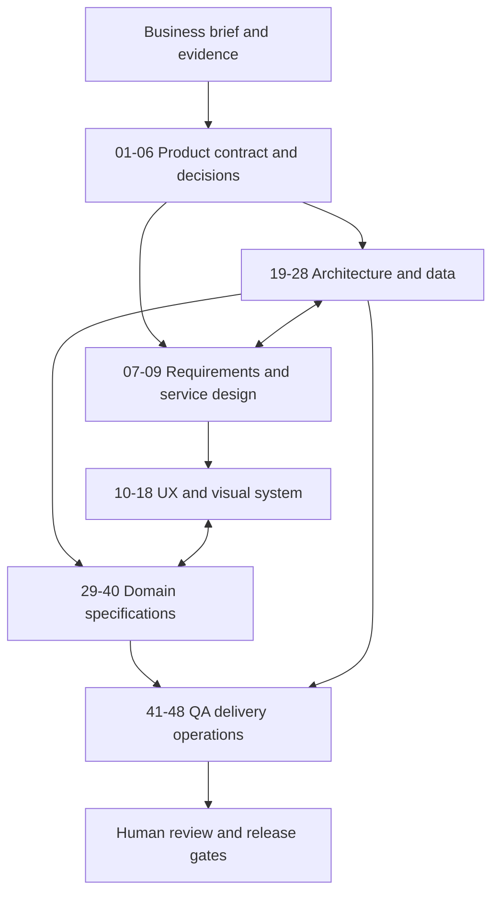
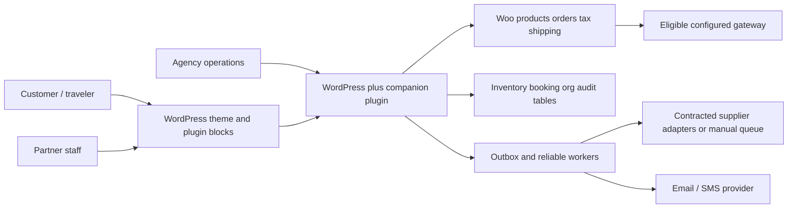

# MASTER DOCUMENTATION PACKAGE — ATLAS LEISURE ECOSYSTEM

Version: 0.1 specification baseline · Date: 2026-11-17 · Brand: placeholder, not approved.

Purpose: navigation, authority, dependency map and completion tracking for the WordPress/WooCommerce theme and travel-platform product.

Prepared from perspectives: product, architecture, delivery, QA. Accountable reviewer: Product Owner. Dependencies: [original brief](_sources/ORIGINAL-PROMPT.md). Approval gate: accept scope/decisions in DOC-05/06 before implementation. Status: DRAFT specification; human review pending.

## 1. Package contract

CONFIRMED: the requested stack is WordPress with a WooCommerce-compatible customizable theme, EN/FA, and separately owned domain functionality. RECOMMENDATION: deliver a reusable block theme plus separately installable modular companion plugins, first configured for one agency. This is a specification package; no application, gateway, live booking, Figma prototype, artwork or legal approval has been produced.

MVP is a complete manual-operations slice: public bilingual catalog, physical souvenirs, fixed-capacity departures/events/basic cohorts, signed-in checkout, a verified eligible domestic gateway, exception/refund handling and limited partner proposal portals. Stays, transport and rentals initially expose request-for-quote workflows. Full later-phase specifications are retained below so subsequent work has defined boundaries.

## 2. Completion manifest and dependencies

“Written” means substantive draft content exists; it does not mean approved, implemented or tested. All documents require accountable reviewer signoff. Machine-readable status: [_meta/manifest.json](_meta/manifest.json). Validation record: [_meta/VALIDATION.md](_meta/VALIDATION.md).

| ID / document | Primary dependencies | Draft status |
|---|---|---|
| [DOC-00 Master index](DOC-00_MASTER-INDEX.md) | brief | Written |
| [DOC-01 Vision/business model](DOC-01_VISION-BUSINESS-MODEL.md) | brief,06 | Written |
| [DOC-02 Research/benchmarks](DOC-02_RESEARCH-BENCHMARKS.md) | brief | Written |
| [DOC-03 Personas/JTBD/journeys](DOC-03_PERSONAS-JTBD-JOURNEYS.md) | 01,02 | Written |
| [DOC-04 Stakeholders/team/RACI](DOC-04_STAKEHOLDERS-TEAM-RACI.md) | 01 | Written |
| [DOC-05 Scope/MVP/roadmap](DOC-05_SCOPE-MVP-ROADMAP.md) | 01,02,06 | Written |
| [DOC-06 Terminology/rules/decisions](DOC-06_TERMINOLOGY-RULES-DECISIONS.md) | brief,02 | Written |
| [DOC-07 BRD/SRS](DOC-07_BRD-SRS.md) | 05,06,19,22 | Written |
| [DOC-08 Stories/acceptance](DOC-08_USER-STORIES-ACCEPTANCE.md) | 07,24 | Written |
| [DOC-09 Use cases/service blueprints](DOC-09_USE-CASES-SERVICE-BLUEPRINTS.md) | 03,07,24 | Written |
| [DOC-10 Information architecture](DOC-10_INFORMATION-ARCHITECTURE.md) | 03,05,22 | Written |
| [DOC-11 UX flows/wireframes](DOC-11_UX-FLOWS-WIREFRAMES.md) | 07,10,23,24 | Written |
| [DOC-12 Design system/UI kit](DOC-12_DESIGN-SYSTEM-UI-KIT.md) | 11,16,17,20 | Written |
| [DOC-13 Motion/microinteractions](DOC-13_MOTION-MICROINTERACTIONS.md) | 12,16 | Written |
| [DOC-14 2D illustration/art](DOC-14_2D-ILLUSTRATION-ART-DIRECTION.md) | 01,12 | Written |
| [DOC-15 3D/fantasy characters](DOC-15_3D-FANTASY-CHARACTERS.md) | 14,16,28 | Written |
| [DOC-16 Accessibility](DOC-16_ACCESSIBILITY-INCLUSIVE-DESIGN.md) | 07,11 | Written |
| [DOC-17 I18N EN/FA/RTL](DOC-17_I18N-EN-FA-RTL.md) | 06,10,22 | Written |
| [DOC-18 Content/SEO/growth](DOC-18_CONTENT-SEO-GROWTH.md) | 10,17 | Written |
| [DOC-19 Architecture/ADRs](DOC-19_SYSTEM-ARCHITECTURE-ADRS.md) | 05,06,02 | Written |
| [DOC-20 Theme](DOC-20_WORDPRESS-THEME-SPEC.md) | 12,17,19 | Written |
| [DOC-21 Plugin architecture](DOC-21_CUSTOM-PLUGIN-ARCHITECTURE.md) | 19,22,23 | Written |
| [DOC-22 Data model](DOC-22_DATA-MODEL-ERD-DICTIONARY.md) | 06,19 | Written |
| [DOC-23 Identity/RBAC/tenancy](DOC-23_IDENTITY-RBAC-TENANCY.md) | 04,22,27 | Written |
| [DOC-24 Booking/inventory/registration](DOC-24_BOOKING-INVENTORY-REGISTRATION.md) | 06,22,25 | Written |
| [DOC-25 Woo commerce](DOC-25_WOOCOMMERCE-COMMERCE-ENGINE.md) | 19,22,24,37 | Written |
| [DOC-26 APIs/integrations](DOC-26_APIS-INTEGRATION-CONTRACTS.md) | 22,23,24,25 | Written |
| [DOC-27 Security/privacy](DOC-27_SECURITY-PRIVACY-THREAT-MODEL.md) | 22,23,43 | Written |
| [DOC-28 Infrastructure/reliability](DOC-28_INFRA-DEVOPS-RELIABILITY.md) | 19,24,27 | Written |
| [DOC-29 Tour itineraries](DOC-29_TOUR-LEADER-ITINERARIES.md) | 22,23,24 | Written |
| [DOC-30 Events](DOC-30_EVENTS-MANAGEMENT.md) | 22,24,25 | Written |
| [DOC-31 Academy](DOC-31_ACADEMY-COURSES-COHORTS.md) | 22,24,25 | Written |
| [DOC-32 Accommodation](DOC-32_ACCOMMODATION-PORTAL.md) | 22,24,36 | Written |
| [DOC-33 Passenger ticketing](DOC-33_FLIGHTS-RAIL-BUS-TICKETING.md) | 24,26,37 | Written |
| [DOC-34 Transfers/rentals](DOC-34_TRANSFERS-AND-RENTALS.md) | 22,24,36 | Written |
| [DOC-35 Souvenirs/manufacturing](DOC-35_SOUVENIRS-MANUFACTURING.md) | 25,36,39 | Written |
| [DOC-36 Partners/contracts](DOC-36_PARTNER-PORTALS-CONTRACTS.md) | 23,26,39 | Written |
| [DOC-37 Domestic payments](DOC-37_PAYMENTS-DOMESTIC-GATEWAYS.md) | 24,25,26,43 | Written |
| [DOC-38 Dormant crypto](DOC-38_CRYPTO-PAYMENT-COMPLIANCE.md) | 37,39,43 | Written |
| [DOC-39 Finance/pricing](DOC-39_FINANCE-PRICING-SETTLEMENTS.md) | 25,36,37,43 | Written |
| [DOC-40 Support/notifications](DOC-40_SUPPORT-NOTIFICATIONS-CRM.md) | 23,26,27 | Written |
| [DOC-41 QA strategy](DOC-41_QA-TEST-STRATEGY.md) | 07,08,24,25,27 | Written |
| [DOC-42 Analytics/observability](DOC-42_ANALYTICS-OBSERVABILITY-KPIS.md) | 01,26,27,28 | Written |
| [DOC-43 Legal review](DOC-43_LEGAL-REGULATORY-REVIEW.md) | 01,02,36,37,38 | Written |
| [DOC-44 Implementation backlog/estimates](DOC-44_IMPLEMENTATION-BACKLOG-ESTIMATES.md) | 05,19,41,45 | Written |
| [DOC-45 Risks/controls](DOC-45_RISKS-DECISIONS-CONTROLS.md) | 06,19,43 | Written |
| [DOC-46 Traceability](DOC-46_TRACEABILITY-MATRIX.md) | 07,08,11,22,26,41 | Written |
| [DOC-47 Runbooks](DOC-47_OPERATIONS-RUNBOOKS.md) | 28,37,39,40 | Written |
| [DOC-48 Launch/UAT/handover](DOC-48_LAUNCH-UAT-HANDOVER.md) | 41,43,44,45,47 | Written |

## 3. Dependency map and reading order

Dependencies describe revision relationships, not a requirement to finish every upstream document before useful drafting. Circular review among design, architecture and security is intentional; freeze coherent versions together.

Start with 01,05,06,19,22,24,25, then 07/08/11/20/21 and the relevant domain. DOC-46 is the bridge between feature, UI, persistence, API, test, phase and owner. DOC-48 is the release evidence checklist.

## 4. Context and conceptual model

One operator manages organizations; members may act for several organizations. Catalog content has offers and dated inventory. Accepted holds become bookings linked to Woo order items; payments and supplier confirmations remain separate. Travelers, payers and attendees can differ. Partners submit proposals while the agency approves customer-facing commitments. [DOC-22](DOC-22_DATA-MODEL-ERD-DICTIONARY.md) owns the detailed ERD.

## 5. Evidence and usage

`CONFIRMED` identifies supplied business intent or directly supported technical guidance, never inferred production readiness. `ASSUMPTION`, `RECOMMENDATION`, `DEPENDENCY`, `OPEN DECISION`, `REGULATORY REVIEW REQUIRED`, and `VERIFY BEFORE BUILD` preserve uncertainty. The [decision ledger](DOC-06_TERMINOLOGY-RULES-DECISIONS.md) controls conflicts. Entity definitions belong to DOC-22, API contracts DOC-26, registration policy DOC-24, money policy DOC-39. Changes to any require impact review of DOC-46 and downstream tests.

Quality self-assessment (0–5): completeness 4; specificity 4; consistency 4; value 4; WP feasibility 4; security/privacy 4; compliance 4; accessibility/localization 4; testability 4; traceability 4. Scores concern documentation and are provisional; external compatibility, design review and legal decisions remain unverified. Gate: all 49 files, source snapshot, ledgers, eight worked scenarios and validation report present; accountable reviewers approve before building.
