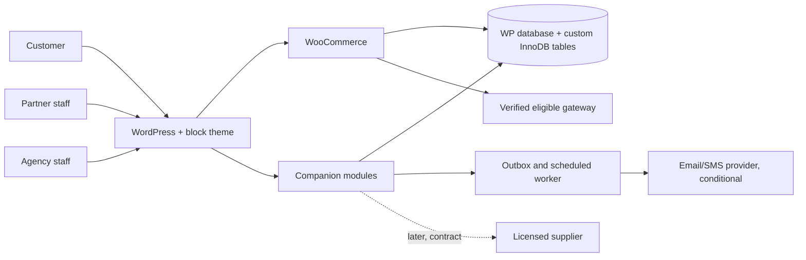

# DOC-19 — System architecture and technical decisions

**Purpose:** Define deployable boundaries, dependencies and tradeoffs for the first release and later growth.  
**Prepared from perspectives:** WordPress, WooCommerce, integration, booking, privacy and operations architects.  
**Accountable reviewer:** Solution architect, with product, security and finance review.  
**Dependencies:** [scope](DOC-05_SCOPE-MVP-ROADMAP.md), [decisions](DOC-06_TERMINOLOGY-RULES-DECISIONS.md), [data](DOC-22_DATA-MODEL-ERD-DICTIONARY.md).  
**Approval gate:** Approve product packaging, MVP scope and hosting before architecture is used for implementation.  
**Status:** DRAFT specification; review pending.

## 1. Context and deployment

**ASSUMPTION / ADR-001:** one WordPress installation serves one agency, with multiple scoped partner organizations; this is not a multi-agency SaaS design and does not assume Multisite. The reusable block theme and companion plugins are distributed and versioned separately. A customer, partner staff member or operator can hold multiple identities on one account. Physical merchandise, events, tour departures and cohorts are purchasable in MVP; stays, transport and rentals are manual requests only. Suppliers and gateway are independently contracted and have no assumed API. Crypto is off in every phase pending separate approval.

The visitor browser is untrusted. WordPress serves content and authenticated REST routes. The theme owns presentation and editing; business modules own domain data and rules; WooCommerce owns commerce order snapshots; a gateway adapter verifies provider results. WordPress and custom tables share an environment, but that does not make external requests atomic. Queue messages contain identifiers and minimum operational metadata rather than traveler details. See [API contracts](DOC-26_APIS-INTEGRATION-CONTRACTS.md).

## 2. Decisions and boundaries

| ADR | Proposed choice | Alternative and reason for decision |
|---|---|---|
| ADR-002 | Block theme with templates, theme.json and Woo styles | Classic/hybrid if gateway or required editor integration proves incompatible; record regression coverage. |
| ADR-003 | Separately installable modular companion, modules internally separated | Many plugins add dependency and upgrade complexity; one monolith weakens module isolation. |
| ADR-004 | Woo CRUD/order items are commerce authority; domain booking records are fulfillment authority | Direct order table reads can break HPOS; booking state must not be inferred from order state. |
| ADR-005 | Dedicated InnoDB inventory/hold records with constraints | Post meta lacks convenient atomic capacity semantics; final schema requires load and concurrency verification. |
| ADR-006 | Acceptance at atomic in-window hold; deadline bounded by window close | Callback is asynchronous and can follow closing; see [booking](DOC-24_BOOKING-INVENTORY-REGISTRATION.md). |
| ADR-007/008 | One merchant, separate incompatible carts, integer IRR | Mixed fulfillment and ambiguous currency increase reconciliation and tax risk. |
| ADR-009 | One eligible verified gateway for MVP; Blocks primary, classic tested only if declared supported | Buy if an extension passes documented due diligence; otherwise build maintained adapter subject to access and permission. |
| ADR-010/011 | English/Persian, org-scoped authorization | Locale, calendar, partner membership and object checks remain distinct. |
| ADR-012/013 | RFQ first for external inventory; transactional outbox and real server scheduling | Supplier APIs and visitor-triggered scheduling cannot be presumed reliable. |
| ADR-014–020 | Minimize PII; threat model; proposed SLO; optional art; build/buy review; distribution and release evidence | Approvals and contracts remain open; [decision ledger](DOC-06_TERMINOLOGY-RULES-DECISIONS.md) is authoritative. |

## 3. Build/buy/hybrid assessment

| Capability | Proposed route | Gate and exit |
|---|---|---|
| Theme and editing | Build reusable theme using WordPress APIs | Test activation, editor, switch, RTL and Woo absent. |
| Commerce, physical stock and taxes | Woo core, configure agency policies | Finance verifies actual tax and shipping behavior. |
| Fixed local event/tour/cohort inventory | Build companion transactional module | Concurrency and recovery tests; no live supplier promise. |
| Gateway | Hybrid: choose maintained compatible extension or adapter | Provider contract, credentials, sandbox, Blocks, HPOS and unit verification. |
| Partner organizations | Build thin membership and record authorization | Security review of exports, caches and async jobs. |
| Email/SMS, search, PMS and travel suppliers | Buy/integrate only with verified agreements | Provider data, privacy, support and fallback approved; stay RFQ or manual until then. |
| Academy assessment and certificates | P2 evaluate extension vs build | Portability and cohort model proof, legal review of claims. |

## 4. Failure and scaling

**WF-REG-001** creates a bounded hold under a short local transaction, then emits an outbox request for order processing. Payment verification occurs outside the transaction; booking confirmation waits for verified payment and agency confirmation. Unknown provider outcome enters reconciliation rather than a second charge. If a successful payment no longer has an allocated hold, create an exception/refund task. This is a distributed workflow with compensation, not a single cross-provider transaction.

Scale begins with one database and real scheduler. Propose moving search to a separate index only after representative load testing shows database queries exceed agreed budget; use index as a derived, rebuildable view, never stock authority. A separate queue/service is considered when measured job lag or deployment isolation cannot meet approved SLO; ownership, consistency and replay rules must precede extraction. No numerical capacity is claimed measured.

## 5. Example, acceptance and open decisions

Fictional 30-seat event: two customers race for seat 30; only the successful hold transaction is accepted. An order can be paid yet booking remains `paid_pending_confirmation`; a supplier reference or Woo order status alone does not confirm ticket issuance. Agency reviews exception with audit. **TC-REG-002** runs a concurrent last-seat test; **TC-PAY-001** repeats verified callback; **TC-AUTH-001** attempts another organization's export. All must pass before release.

**OPEN DECISION:** distribution market, license, hosting jurisdiction, gateway, versions, target traffic and operational staffing. Product owner, counsel and technical lead approve before release; decisions and contract evidence go into DOC-06 and DOC-45.

## Review and evidence

All decisions are proposed, not approved; no implementation, operational measurement or supplier integration is implied. Accountable reviewers must record sign-off and evidence before release. Provider interfaces, compatibility versions and legal conclusions remain VERIFY BEFORE BUILD.

**Self-assessment, 0–5:** completeness 4 (document scope covered); specificity 4 (concrete contracts); consistency 4 (shared baseline); user value 4 (actionable decisions); implementation feasibility 4 (platform boundaries); security/privacy 4 (controls proposed); compliance 3 (qualified legal/provider verification outstanding); accessibility/localization 4 (cross-referenced standards); testability 4 (observable checks); traceability 4 (canonical IDs). A score of 3 is a release blocker until evidence and qualified review exist; see [risk register](DOC-45_RISKS-DECISIONS-CONTROLS.md). These are author estimates, not independent audit findings.
