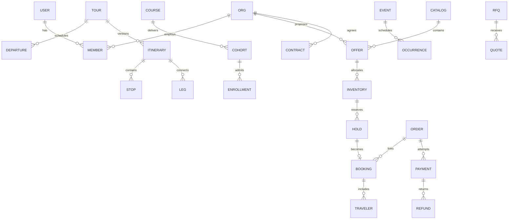

# DOC-22 — Canonical data model and dictionary

**Purpose:** Define authoritative entity meanings, ownership, persistence and integrity for implementation.  
**Prepared from perspectives:** Data, WooCommerce, booking, security and domain operations architects.  
**Accountable reviewer:** Data architect; domain and privacy owners review.  
**Dependencies:** [architecture](DOC-19_SYSTEM-ARCHITECTURE-ADRS.md), [booking](DOC-24_BOOKING-INVENTORY-REGISTRATION.md), [authorization](DOC-23_IDENTITY-RBAC-TENANCY.md).  
**Approval gate:** Approve field definitions, retention and actual provider constraints before migration.  
**Status:** DRAFT specification; review pending.

## 1. Relationship model

Diagram is conceptual: verified Woo APIs own order persistence; relationship cardinalities are scoped to deployment and can require join records. A booking is not a Woo order or a provider-issued ticket. All identifiers are immutable opaque internal IDs unless otherwise specified. Monetary fields are integer IRR for MVP; currency and unit travel with every amount. Named IANA zone accompanies normalized UTC instants; date-only stay boundaries are local dates, not midnight UTC assumptions.

## 2. Authoritative entity dictionary

Classification: **P** personal/confidential, **C** commercial confidential, **O** operational/public subject to visibility. Common rows carry `id`, `created_at_utc`, `updated_at_utc`, `version`; scoped rows carry `org_id` where applicable. Field lists are minimums, not permission to retain excessive PII. `WP` denotes WordPress object/CPT or user, `WC` Woo CRUD-owned, `SQL` custom InnoDB table. Exact table prefixes and portable foreign-key/migration support are implementation decisions.

| ID | Definition and minimum fields | Storage / class |
|---|---|---|
| ENT-USER | WordPress person: account ID, login identity, locale, status; customer and multiple staff memberships possible. | WP / P |
| ENT-ORG | Partner organization: legal/display name, status, agency approval, primary contact reference. | SQL / P,C |
| ENT-MEMBER | User–organization membership: org, user, scoped role, status, effective dates; unique active membership. | SQL / P |
| ENT-CATALOG | Public browsable taxonomy and localized listing projection: type, destination, language, visibility. | WP / O |
| ENT-OFFER | Purchasable or RFQ-only commercial proposal: owner, type, visibility, currency, price/version, eligibility and cancellation reference. | SQL + WP projection / C |
| ENT-TOUR | Reusable tour definition: owner org, title, duration, group rules, publication and current itinerary version. | WP + SQL / C |
| ENT-DEPARTURE | Scheduled tour delivery: tour/version, dates, registration window, timezone, capacity, operational state. | SQL / C |
| ENT-STOP | Itinerary destination and timing: itinerary, order, location, local timezone, arrival/departure, overnight. | SQL / O,C |
| ENT-LEG | Transfer between stops: mode, origin/destination, planned instants, supplier reference, baggage and status. | SQL / C |
| ENT-ITINERARY | Versioned day/item schedule: tour, revision, approval, timestamps, traveler summary and confidential notes separated. | SQL / C |
| ENT-EVENT | Reusable event definition: type, organizer, content and publication. | WP + SQL / O |
| ENT-OCCURRENCE | A scheduled event: event, venue, timezone, window, capacity, tier/eligibility references and state. | SQL / C |
| ENT-COURSE | Reusable Academy syllabus: learning objectives, content version, prerequisites and owner. | WP + SQL / O |
| ENT-COHORT | Course delivery: course version, venue, instructor, schedule, registration window, price and capacity. | SQL / C |
| ENT-ENROLLMENT | Learner’s cohort participation: booking, learner reference, eligibility, attendance and status. | SQL / P |
| ENT-PROPERTY | Partner accommodation: owner, location, compliance status, property type and publication. | WP + SQL / P,C |
| ENT-UNITTYPE | Room/category definition: property, occupancy, amenities, total or managed inventory. | SQL / C |
| ENT-UNIT | Specific room or whole property: property, type, identifier, availability and operational state. | SQL / C |
| ENT-RATE | Rate plan/version: offer, local dates, occupancy, amount/currency, cancellation and restrictions. | SQL / C |
| ENT-INVENTORY | Capacity resource and interval/slot: subject, unit type, period, capacity, allocated, version. | SQL / C |
| ENT-HOLD | Time-bounded allocation: inventory, accepted_at, expires_at, quantity, idempotency key, status. | SQL / P,C |
| ENT-BOOKING | Service fulfillment aggregate: offer snapshot, hold/order IDs, customer, status, agency confirmation and cancellation. | SQL / P,C |
| ENT-TRAVELER | Separate participant/guardian reference: booking, minimal name/contact/eligibility; sensitive document fields only if necessary. | SQL protected / P |
| ENT-ORDER | Woo authoritative order and line-item commerce snapshot via CRUD: status, totals, tax/shipping, customer. | WC / P,C |
| ENT-PAYMENT | Provider attempt and verified facts: order, amount/currency, provider reference, status, authoritative local verification completion time, trustworthy provider paid_at when available, and verification evidence. | SQL or controlled Woo metadata / P,C |
| ENT-REFUND | Independent refund case: payment, amount, reason, approval, provider reference and state. | SQL + WC CRUD linkage / P,C |
| ENT-LEDGER | Append-only accounting event: order/booking/partner, amount, currency, event type, effective time and reversal reference. | SQL / C |
| ENT-CONTRACT | Agency–partner terms/version: parties, effective dates, commission or net pricing, evidence and approval. | SQL protected / P,C |
| ENT-RFQ | Request for quote: requestor, category, requirements, deadline, scoped recipients and status. | SQL / P,C |
| ENT-QUOTE | Response: RFQ, supplier, expiry, price/currency, exclusions, status and revision. | SQL / C |
| ENT-VEHICLE | Rental or transfer asset: operator, category, asset reference, capacity, availability and maintenance. | SQL / C |
| ENT-RENTAL | Rental agreement/fulfillment: booking, vehicle/category, pickup/return, driver verification and deposit state. | SQL / P,C |
| ENT-MERCH | Woo product/variation for physical goods: SKU, stock, attributes, shipping/tax class and price. | WC / C |
| ENT-PRODUCTION | Manufacturer job: quote/order, approved design version, milestones, batch, QC and fulfillment. | SQL / C |
| ENT-TICKET | Evidence of entitlement or supplier issuance: booking, issuer, reference, type, validity and status; a Woo order alone is not issuance. | SQL / P,C |
| ENT-CERTIFICATE | Completion evidence: enrollment, issuer, criteria/version, verification reference, issue/revocation status. | SQL / P |
| ENT-SUPPORT | Case: requester, authorized booking reference, category, priority, assignee, state and minimal messages. | SQL / P |
| ENT-NOTIFICATION | Delivery intent: recipient reference, template/version, channel, locale, consent basis, status and attempts. | SQL / P |
| ENT-AUDIT | Append-only security/operational record: actor/service, action, object, time, reason, correlation and outcome. | SQL / P,C |
| ENT-OUTBOX | Transactional event awaiting delivery: event ID, type/version, aggregate, minimal payload, created/claimed, attempt and status. | SQL / C |

## 3. Integrity, indexes and retention

Unique active membership `(org_id,user_id)`; unique idempotency `(actor_or_scope,operation,key)` with stored request hash; unique provider attempt/reference per provider when verified; one active hold allocation per idempotency operation. Inventory resources use deterministic lock order and indexed resource/time dimensions. Date overlap across rows needs explicit locking or a tested interval allocation algorithm; a simple unique index is insufficient. Store capacity as constrained nonnegative integers and enforce `allocated <= capacity` transactionally. Index bookings by authorized user/status and partner-scoped subject, outbox by state/next-attempt, audit by object/time. Partitioning and encryption choices are proposed, not verified.

Preserve price, cancellation, schedule and policy snapshots linked to the accepted booking and Woo order. Later edits create versions rather than silently changing historic terms. Anonymize or erase PII according to an approved field-level schedule, legal holds and financial retention; do not promise a fixed retention period until counsel approves. Limit exported fields and record access. Separate customer-facing projections from net supplier cost and operational notes.

## 4. Example and verification

Fictional occurrence O1 has capacity 30 and 29 allocated; hold H1 for one seat has `accepted_at_utc`, `expires_at_utc`, unique key and actor. Two simultaneous transactions compete for the final allocation; **TC-REG-002** requires one success and nonnegative capacity. **TC-DATA-001** checks unique membership and idempotency conflict; **TC-DATA-002** switches HPOS and uses Woo CRUD; **TC-DATA-003** verifies supplier cost omitted from public response; **TC-DATA-004** restores a backup and reconciles orders, booking, payment and outbox.

**OPEN DECISION:** actual engine/schema, indexing based on measured access patterns, retention, encryption keys and legacy imports. Woo order storage is not a stable public schema; use the [HPOS recipe book](https://developer.woocommerce.com/docs/features/orders/high-performance-order-storage/recipe-book/), retrieved 2026-11-17.

## Review and evidence

All decisions are proposed, not approved; no implementation, operational measurement or supplier integration is implied. Accountable reviewers must record sign-off and evidence before release. Provider interfaces, compatibility versions and legal conclusions remain VERIFY BEFORE BUILD.

**Self-assessment, 0–5:** completeness 4 (document scope covered); specificity 4 (concrete contracts); consistency 4 (shared baseline); user value 4 (actionable decisions); implementation feasibility 4 (platform boundaries); security/privacy 4 (controls proposed); compliance 3 (qualified legal/provider verification outstanding); accessibility/localization 4 (cross-referenced standards); testability 4 (observable checks); traceability 4 (canonical IDs). A score of 3 is a release blocker until evidence and qualified review exist; see [risk register](DOC-45_RISKS-DECISIONS-CONTROLS.md). These are author estimates, not independent audit findings.
