# DOC-24 — Booking, inventory and registration

**Purpose:** Define atomic admission, payment races, allocation and recovery for fixed-capacity services.  
**Prepared from perspectives:** Booking concurrency, event, tour, Academy, finance and QA.  
**Accountable reviewer:** Booking engineering lead; operations and finance review.  
**Dependencies:** [data](DOC-22_DATA-MODEL-ERD-DICTIONARY.md), [commerce](DOC-25_WOOCOMMERCE-COMMERCE-ENGINE.md), [contracts](DOC-26_APIS-INTEGRATION-CONTRACTS.md).  
**Approval gate:** Concurrency, timing, reconciliation and usability tests pass against production-like environment.  
**Status:** DRAFT specification; review pending.

## 1. Scope and invariants

MVP reserves manually managed local event occurrences, fixed-capacity tour departures and cohorts, never supplier inventory. `ENT-INVENTORY` capacity, `ENT-HOLD` and `ENT-BOOKING` are domain authority. Woo order state, gateway redirect, supplier status and booking state are independent. **NFR-CONC-001:** committed allocations cannot exceed capacity, including concurrent group requests and admin exceptions. Group quantity is all-or-nothing in MVP; never silently admit a partial party. Published visibility does not imply open registration, and an RFQ does not imply available stock.

**ADR-006:** ordinary public admission is accepted only when a local atomic hold is created with `registration_open_at <= server_now < registration_close_at`, user eligible, offer approved/published and capacity available. Use UTC instants and the configured IANA zone for display. The hold expiry and payment deadline are `min(accepted_at + 10 minutes, registration_close_at)`; there is no grace period or extension. At the deadline the hold is expired for new hold-related customer writes and payment initiation, even if the expiry worker has not released its allocation. Existing valid paid accepted booking may be confirmed after close; no new public admission after close.

The independent provider verification result has an authoritative locally recorded completion time. If verification completes locally **at or before** the payment deadline, it may consume the still-allocated hold without a trustworthy provider `paid_at`. If verification completes **after** the deadline, it may consume the still-unreleased allocation only when a trustworthy provider `paid_at <= payment_deadline` is independently verified. Both branches serialize consumption against the expiry transition on the same hold row. If the expiry transition already released the allocation, never reacquire it automatically: preserve verified payment, transition an expired booking to exception, and arrange manual resolution/refund. If verification is late and the provider payment time cannot be trusted, enter manual exception. Verified payment is monotonic; a later refund is separate. A payment in flight never blocks expiration indefinitely. Provider timestamp trust and policy approval remain launch gates.

## 2. Transaction and state model

```mermaid
stateDiagram-v2
  [*] --> held: eligible in-window allocation
  held --> pending_payment: linked order/payment initiated
  pending_payment --> paid_pending_confirmation: verified timely payment + allocated hold
  paid_pending_confirmation --> confirmed: agency confirms
  confirmed --> fulfilled: service delivered
  held --> expired: deadline and release
  pending_payment --> expired: deadline and release
  pending_payment --> exception: verified paid but payment time unknown after deadline
  expired --> exception: later verified payment; allocation remains released
  paid_pending_confirmation --> exception: operational failure
  confirmed --> canceled: authorized cancellation
```

This diagram describes booking; hold state also changes (`active`, `consumed`, `released`) and payment state is `created → pending → verified/failed/unknown`. An admin exception to public cutoff requires actor, reason and audit and still atomically checks capacity; it never asserts payment verification. Waitlist offer after close is not public admission and cannot be accepted without such exception. Refund case is `requested → approved → submitted → succeeded/failed`; payout and supplier confirmation remain separate.

## 3. Algorithm and locking

**WF-REG-001:** (1) Authenticate, normalize request, validate input and idempotency key. (2) Begin a short database transaction, lock relevant inventory resource rows in deterministic order; read authoritative server time, offer revision and current eligibility. (3) If outside window, sold out, suspended or insufficient remaining capacity, roll back with a localized actionable error. Otherwise increment allocation, insert hold with expiry and record request-hash/idempotency result, commit. (4) Create/link Woo order through a separate idempotent process; a failure triggers safe compensating release or recoverable retry, never a remote call inside the lock. (5) Initiate payment through the approved adapter only before the deadline; do not allow a new hold-related customer write or new payment initiation at or after it. (6) Independently verify provider outcome outside the transaction and persist the authoritative local verification completion time; under local lock re-read hold state and verify amount/currency. Verification completed at or before the deadline may consume a still-allocated hold without provider paid_at; later verification additionally needs a trustworthy provider paid_at at or before the deadline. Otherwise record exception. If release already won, move expired booking to exception, preserve verified payment and do not reacquire inventory. (7) Agency confirms according to workflow and sends confirmation after commit.

Expiry worker locks the same hold and inventory rows in a consistent order and releases once if still active and deadline reached. Whichever authorized transition commits first determines whether allocation is still held; a payment verified after expiry already released becomes exception even if timely paid. The worker must not accidentally release a consumed hold. Local invariant and job idempotency are enforced with unique keys/transactions and tested on the chosen DB isolation level. Never hold locks while querying gateway or sending messages. A reliable external scheduler drives expiration and reconciliation, but display computes availability from authoritative state, not a browser clock.

## 4. Resource variants and future scope

| Resource | Correct allocation basis | Phase |
|---|---|---|
| Event, tour departure, cohort | capacity per occurrence/departure/cohort and tier quotas; instructor/session overlap separately checked | MVP |
| Hotel category | each overlapping local room-night, occupancy/rate plan; deterministic locks for all nights | P2, subject to contracts |
| Whole villa | exclusive unit/date interval; manual blocks count as occupied | P2 |
| Vehicle | asset or category and pickup/return interval including turnaround/maintenance; prevent overlapping allocations | P2 |
| Airline, rail, bus | licensed supplier-defined hold and expiry, seat and fare rules | P3 only with provider evidence |

External inventory can be stale; only an actual supplier-side confirmation provides a supplier guarantee. Manual requests for stays, transport and rentals do not charge or promise stock in MVP. Changing capacity below allocated count is rejected or escalated as a documented exception; changing dates/terms on already booked events creates an impact review and notification, not silent changes.

## 5. Example and tests

Fictional occurrence in `Asia/Tehran` closes at 18:00 local, capacity 30. At 17:58, a successful one-seat hold has a deadline of 18:00, not 18:08. Verification completed locally at 17:59:30 may consume the still-allocated hold without provider paid_at; after that consumption, agency confirmation can occur after close. Verification completed locally at 18:00:01 can consume an unreleased hold only if trusted provider paid_at is at or before 18:00. If expiry has already released the allocation, either verified payment becomes an exception/refund and never causes automatic reacquisition. At exactly 18:00, a new public hold or payment initiation is rejected. A refreshed browser countdown cannot create a right to a seat.

**TC-REG-001:** check just before open, exactly open, just before close and exactly close using controlled server time. **TC-REG-002:** two parallel last-seat requests yield one success; assert allocation and count. **TC-REG-003:** verify locally at or before deadline without provider paid_at while allocation is unreleased; verify after deadline with trusted timely paid_at while unreleased; verify after deadline with missing/untrusted or late paid_at; and race verification against release. When release wins, assert `expired -> exception`, payment stays verified, allocation stays released, manual refund is queued and no oversell occurs. **TC-REG-004:** duplicate key same payload returns same result; changed payload conflicts. **TC-REG-005:** timezone offset changes, ambiguous local input and server/browser clock disagreement are handled explicitly. **TC-REG-006:** post-close waitlist and privileged exception enforce audit and capacity. **TC-REG-007:** provider timeout or stale inventory never produces confirmed ticket.

**OPEN DECISION:** eligibility, waitlist and supplier timing specifics; provider timestamp trust and financial remedy require actual agreements. Retention and manual exception authority require counsel and operations signoff.

## Review and evidence

All decisions are proposed, not approved; no implementation, operational measurement or supplier integration is implied. Accountable reviewers must record sign-off and evidence before release. Provider interfaces, compatibility versions and legal conclusions remain VERIFY BEFORE BUILD.

**Self-assessment, 0–5:** completeness 4 (document scope covered); specificity 4 (concrete contracts); consistency 4 (shared baseline); user value 4 (actionable decisions); implementation feasibility 4 (platform boundaries); security/privacy 4 (controls proposed); compliance 3 (qualified legal/provider verification outstanding); accessibility/localization 4 (cross-referenced standards); testability 4 (observable checks); traceability 4 (canonical IDs). A score of 3 is a release blocker until evidence and qualified review exist; see [risk register](DOC-45_RISKS-DECISIONS-CONTROLS.md). These are author estimates, not independent audit findings.
